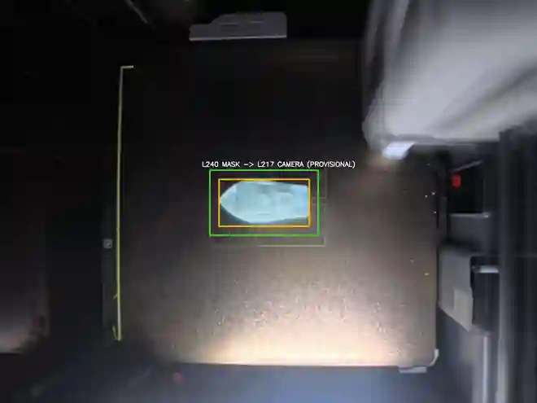
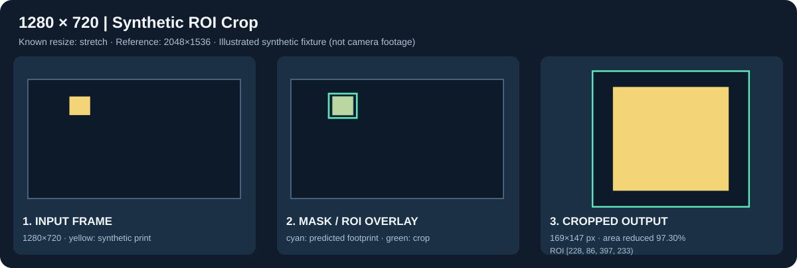

# ROI Crop Module — G-code Stack Mask 기반 관심 영역 추출

**Computer Vision · 3D Printing · Proof of Concept**  
**진행 단계: Python/OpenCV 기능 PoC 진행 중 · 실제 카메라 정합 및 FPGA 연동 미검증**  
최종 정리: 2026-11-11

## 프로젝트 목적

3D 프린팅 공정의 전체 카메라 영상에서 출력물이 위치할 것으로 예상되는 영역만 **관심 영역(ROI, Region of Interest)** 으로 잘라 후속 CV 처리에 전달하는 모듈을 개발합니다.

G-code에서 생성한 **Stack Mask**를 기준으로 출력 예상 영역을 추출한 뒤, 카메라 좌표계로 투영하고 경계 여유(Margin)를 적용합니다. 전처리·결함 검출 등 후속 단계에서 불필요한 배경 픽셀을 줄이고, 장기적으로 **CV–FPGA 파이프라인에 사용할 ROI 인터페이스**를 설계하는 것이 목표입니다. 실제 속도 이득이나 검출 정확도 개선은 아직 측정하지 않았습니다.

```text
G-code Stack Mask → Foreground/BBox → Mask-to-Camera 좌표 변환
                                   → 해상도/리사이즈 대응
                                   → Margin + Boundary Clipping
                                   → ROI Overlay / Crop / Metadata
                                   → (후속) 전처리 · 결함 검출 · FPGA 연동
```

## 시뮬레이션 / 실험 현황

| 순서 | 실험 | 주요 내용 | 현재 상태 |
|---|---|---|---|
| **01** | [Stack Mask 기반 1차 ROI Crop](experiments/roi_crop_stack_poc/README.md) | G-code Stack Mask의 전경 → BBox → 임시 Affine 좌표 변환 → 실제 카메라 프레임 Crop | **기능 PoC 확인**, 원본 기록 기준 단위 테스트 **3/3 PASS** |
| **02** | [Multi-resolution ROI Crop](experiments/roi_crop_multires/README.md) | 2048×1536, 1920×1080, 1280×720, 640×480의 합성 영상에서 해상도별 좌표·Margin 조정 | **합성 기능 검증**, 원본 기록 기준 신규 테스트 **5/5 PASS** |

### 01 · Stack Mask ROI Crop — 실제 촬영 이미지 시각화



- 예시: 2048×1536 카메라 프레임 → **414×249 ROI** (처리 대상 픽셀 면적 **96.72% 감소**).
- **주의:** Mask는 **L240**, 카메라 사진은 **L217**로 레이어가 다릅니다. Affine도 출력물 위치를 참고해 설정한 **임시 값**이므로 독립적인 정합 정확도 검증이 아닙니다.
- [실험 과정·시각화·검증 기록](experiments/roi_crop_stack_poc/README.md)

### 02 · Multi-resolution ROI Crop — 합성 해상도 대응



- 기준 영상에 알려진 리사이즈를 적용한 **4종 합성 프레임**에서 ROI 좌표와 출력 파일을 확인했습니다.
- 1280×720 예시의 ROI는 **169×147**, 입력 대비 대상 픽셀 면적 **97.30% 감소**입니다.
- **주의:** SVG는 합성 결과 설명용 도식입니다. 실제 720p 촬영 영상·실물 카메라 보정·FPGA 처리 성능이 검증된 것은 아닙니다.
- [다중 해상도 실험 및 정량 결과](experiments/roi_crop_multires/README.md)

> 위 감소율은 **입력 영상 대비 Crop 이미지의 픽셀 면적 감소율**입니다. 처리 속도, 메모리 절감, 검출 정확도 향상으로 해석할 수 없습니다.

## 개발 방향 및 다음 단계

1. **실제 데이터 정합:** 동일 레이어 G-code Stack Mask와 카메라 프레임 확보.
2. **독립 카메라 보정:** 베드 기준점 등을 사용해 출력물 위치를 참고하지 않고 Mask→카메라 변환 추정.
3. **해상도 일반화:** 720p 실촬영, 화각·센서 Crop·종횡비 변경 여부 확인 후 필요 시 재보정.
4. **정량 평가:** ROI 누락률, 좌표 오차, IoU, Margin별 범위, 처리시간 및 반복 재현성 측정.
5. **후속 CV/FPGA 연결:** Grayscale/HSV/RGB 및 노이즈 전처리 후보 비교, 확정된 ROI·메타데이터 인터페이스 검토.

현재 **ROI 생성 기능을 구현·시연한 단계**이며, 동일 레이어 실측 정합 정확도, 다중 실촬영 조건에서의 일반화, 실시간성 및 FPGA 동작은 **미검증**입니다.

## 폴더 구성

```text
.
├── README.md
├── experiments/
│   ├── roi_crop_stack_poc/       # 01: 실촬영 프레임 기반 기능 시연·문서·이미지
│   └── roi_crop_multires/        # 02: 다중 해상도 합성 테스트·SVG·생성 스크립트
├── src/
│   ├── roi_crop_stack.py         # 공통 Mask/BBox/단일 해상도 ROI
│   └── roi_crop_multires.py      # 좌표 리사이즈 대응
├── tests/
│   ├── test_roi_crop_stack.py
│   └── test_roi_crop_multires.py
├── requirements.txt
└── .gitignore
```

## 실행 / 재현

Python 3.10+ 권장. 저장소 루트 기준:

```bash
python -m pip install -r requirements.txt
python -m unittest discover -s tests -p 'test_roi_crop_*.py' -v
python experiments/roi_crop_multires/generate_demo.py
```

2차 예제는 **합성 영상만으로 재현 가능**하며 생성된 PNG/JSON은 `experiments/roi_crop_multires/runs/`에 저장됩니다(버전 관리 제외). 1차 재현에는 원본 Stack Mask·카메라 고해상도 파일이 별도로 필요합니다. 실제 입력과 개별 CLI 옵션은 각 실험 README를 참고하세요.

## 출처 및 검증 범위

이 저장소는 [modulino-vision_CV_FPGA](https://github.com/minhosong-mse/modulino-vision_CV_FPGA)의 CV 실험을 독립적으로 정리한 것입니다. [1차 원본](https://github.com/minhosong-mse/modulino-vision_CV_FPGA/tree/main/cv/experiments/roi_crop_stack_poc) · [2차 원본](https://github.com/minhosong-mse/modulino-vision_CV_FPGA/tree/main/cv/experiments/roi_crop_multires)

테스트 PASS와 실험 수치는 원본 프로젝트의 2026-11-10~11 기록에 근거합니다. 이 저장소 재구성만으로 실측 검증이 추가된 것은 아닙니다. CV↔FPGA 인터페이스는 [원본 문서](https://github.com/minhosong-mse/modulino-vision_CV_FPGA/blob/main/docs/INTERFACE.md)의 **DRAFT/미합의** 상태입니다.
