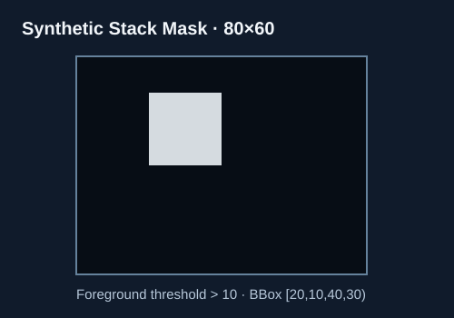
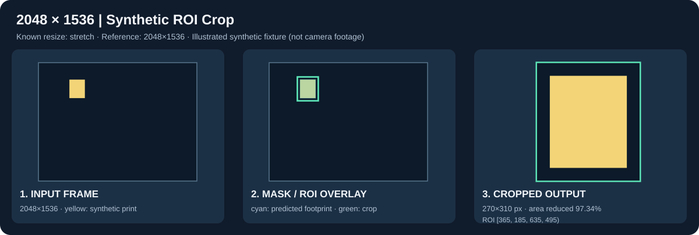
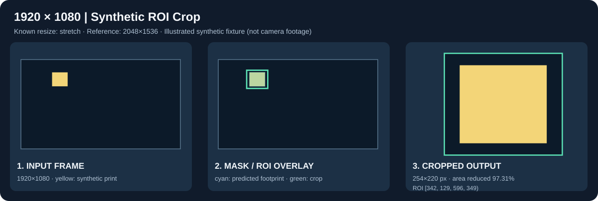
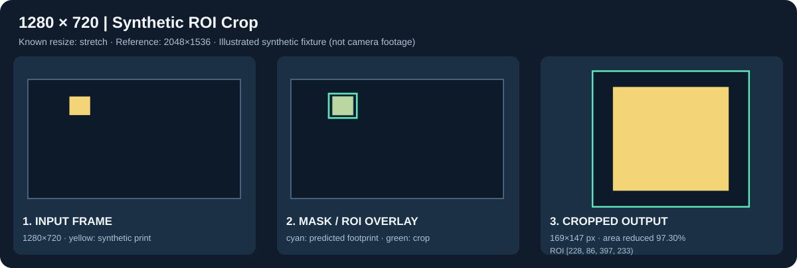
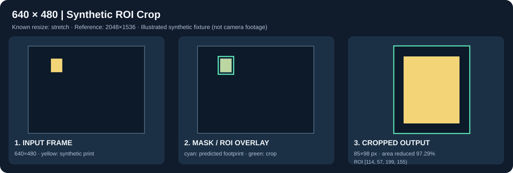

# 2차 실험 — 다중 해상도 G-code Stack Mask ROI Crop

> **출처:** [원본 다중 해상도 실험](https://github.com/minhosong-mse/modulino-vision_CV_FPGA/tree/main/cv/experiments/roi_crop_multires)에서 가져와 독립 실행 경로에 맞게 정리했습니다. 실험 수치·판정은 원본 기록입니다.

**CV Team 최강민 | 2026-11-11 (KST)**

**판정: Python/OpenCV 합성 입력 기능 검증 PASS (신규 테스트 5/5). 실제 720p 카메라 정합 정확도 미검증.**

> **기존 [1차 ROI Crop 실험](../roi_crop_stack_poc/README.md)은 수정하지 않았다.** 아래 이미지는 실제 Bambu P1S 촬영 사진이 아닌 **합성 시험의 확인된 ROI 좌표를 시각화한 SVG 도식**이다. `generate_demo.py`를 실행하면 각 해상도의 실제 **합성 PNG 입력 → Overlay → Crop 출력** 파일을 생성할 수 있다. SVG를 실제 카메라 촬영/정합 증거로 해석하지 말 것.

## 1. 전체 처리 흐름

```text
Synthetic G-code Stack Mask (80×60)
    ↓ grayscale > 10
Foreground bounding box [20,10,40,30)
    ↓ mask→reference-camera affine
Reference projected region [400,220,600,460) on 2048×1536
    ↓ reference→input resize transform (explicit stretch)
    ↓ detect incoming camera width/height
    ↓ transform corners and bbox
    ↓ scale 35px reference margin along x/y, round upward
    ↓ clip ROI to input image boundary
    ↓ generate input_camera.png / roi_overlay.png / roi_crop.png
    ↓ store roi_metadata.json
```



합성 예제에서 기준 변환은 `x_ref=10*x_mask+200`, `y_ref=12*y_mask+100`이다. 네 가지 해상도 모두 동일한 **2048×1536 합성 기준 영상**에서 `cv2.resize(..., INTER_NEAREST)`로 생성한다. 따라서 카메라 화각 변경은 실험하지 않았다.

## 2. 해상도별 입력 이미지와 결과 도출 과정

각 그림은 **① 합성 입력 프레임 → ② G-code Mask 위치 투영(청록색) 및 ROI 표시(초록선) → ③ Crop 결과**를 한눈에 보여준다. 좌표는 실제 합성 처리 코드가 출력한 값이다. 그림 자체는 설명용 벡터 시각화이며, 원본 픽셀 이미지는 4장 모두 [재현 스크립트](generate_demo.py)로 만들 수 있다.

### A — 2048×1536 기준 해상도



- x/y 배율 1.0/1.0, margin 35/35px
- ROI **[365,185,635,495)** → **270×310px**
- ROI 면적 축소율 **97.34%**

### B — 1920×1080 FHD



- x/y 배율 0.9375/0.703125, margin 33/25px
- ROI **[342,129,596,349)** → **254×220px**
- ROI 면적 축소율 **97.31%**

### C — 1280×720 HD (회의 요구 기준)



- x/y 배율 0.625/0.46875, margin 22/17px
- ROI **[228,86,397,233)** → **169×147px**
- ROI 면적 축소율 **97.30%**. **실제 카메라 720p 및 FPGA 성능이 검증된 것은 아니다.**

### D — 640×480 VGA



- x/y 배율 0.3125/0.3125, margin 11/11px
- ROI **[114,57,199,155)** → **85×98px**
- ROI 면적 축소율 **97.29%**

### 수치 비교

| 입력 프레임 | resize 조건 | Margin x,y | Crop [x1,y1,x2,y2) | Crop W×H | 면적 감소 |
|---|---|---|---|---|---|
| 2048×1536 | stretch | 35,35 | [365,185,635,495) | 270×310 | 97.34% |
| 1920×1080 | stretch | 33,25 | [342,129,596,349) | 254×220 | 97.31% |
| **1280×720** | **stretch** | **22,17** | **[228,86,397,233)** | **169×147** | **97.30%** |
| 640×480 | stretch | 11,11 | [114,57,199,155) | 85×98 | 97.29% |

면적 감소율은 `100×(1−Crop픽셀수/입력픽셀수)`로 계산했다. **처리시간, 메모리 감소율, Segmentation 정확도와 무관한 단순 이미지 면적 지표**이다. 결과 요약: [synthetic_results_summary.json](synthetic_results_summary.json).

## 3. 코드·검증·이미지 재생성

- [신규 다중 해상도 ROI Crop 구현](../../src/roi_crop_multires.py): 기존 1차 파일을 호출해 Mask 처리 및 Overlay 재사용, 변환·ROI 처리만 별도 구현
- [신규 5개 테스트](../../tests/test_roi_crop_multires.py): 해상도 좌표, 종횡비 예외, contain/cover, clipping/빈 마스크, 네 크기 파일 입출력
- [합성 전용 기준 좌표 JSON](demo_calibration.json): 실제 카메라 교정값이 아님

저장소 루트에서 실행:

```bash
python -m pip install -r requirements.txt

python -m unittest discover -s tests -p 'test_roi_crop_multires.py' -v

python experiments/roi_crop_multires/generate_demo.py
```

생성되는 파일:

```text
experiments/roi_crop_multires/runs/
├── stack_mask_synthetic.png
├── camera_2048x1536.png
├── camera_1920x1080.png
├── camera_1280x720.png
├── camera_640x480.png
├── summary.json
├── 2048x1536/
│   ├── input_camera.png
│   ├── roi_overlay.png
│   ├── roi_crop.png
│   ├── stack_binary.png
│   └── roi_metadata.json
├── 1920x1080/   (same output file types)
├── 1280x720/    (same output file types)
└── 640x480/     (same output file types)
```

**GitHub에는 결과를 이해하기 위한 가벼운 SVG 5장, 재현 코드와 정량 좌표를 저장**하고, 전체 해상도 합성 PNG는 로컬에서 재생성한다. 실제 촬영 원본은 기존 Google Drive 운용 원칙을 유지한다.

## 4. 해상도 자동 대응 시 주의사항

- 기준 `2048×1536`은 4:3, `1280×720`은 16:9이므로 **리사이즈 방식에 따라 좌표가 다르다**.
- `stretch`: 가로·세로 독립 배율 / `contain`: 비율 보존과 여백 / `cover`: 비율 보존과 중앙 잘림.
- 비율이 바뀌었는데 리사이즈 방식을 지정하지 않았다면 **오류를 반환**한다.
- 실제 카메라 720p 모드에서 화각·렌즈·시점·센서 crop이 달라졌다면, 자동 크기 계산만으로 보정할 수 없다. **출력물 외곽을 사용하지 않은 베드 기준점 등으로 재교정**해야 한다.
- 기존 1차 PoC의 G-code Mask L240과 촬영 사진 L217은 같은 레이어가 아니며 그 affine은 화면 속 출력물을 참고한 시험용 값이다. 2차 합성 보정 JSON도 실물 카메라 교정값이 아니다.

실제 입력 CLI 예시 (**동일 프레이밍이며, 적절한 별도 보정 JSON이 있다는 전제**):

```bash
python src/roi_crop_multires.py \
  --mask /path/to/same_layer_stack.png \
  --camera /path/to/camera_1280x720.png \
  --calibration /path/to/verified_camera_calibration.json \
  --output-dir /path/to/crop_720p \
  --margin 35 --margin-units reference
```

## 5. 현재 판정과 다음 연구 과제

- **기능 검증 완료 (합성 한정):** 2048×1536 / 1920×1080 / 1280×720 / 640×480 입력에서 ROI 계산과 PNG 출력. 신규 테스트 **5/5 PASS**, Python 3.13.5, OpenCV 4.13.0, NumPy 2.3.5 (2026-11-11).
- **미검증:** 실물 Bambu P1S 720p 영상, 동일 레이어 G-code 정합, IoU·누락률, 실제 속도·메모리, FPGA 버퍼·연속처리.
- **후속:** 카메라 영상 720p 획득/프레이밍 확인 → 실제 G-code 동일 레이어 대응 → 베드 기준 독립 교정 → 누락률·실행시간 측정 → Grayscale/HSV/RGB 및 Noise Reduction 연결.
- CV↔FPGA 공식 데이터 규격은 [docs/INTERFACE.md](https://github.com/minhosong-mse/modulino-vision_CV_FPGA/blob/main/docs/INTERFACE.md)에서 **DRAFT/미합의**. 본 실험 JSON은 CV 자체 PoC용이다.
