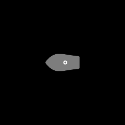
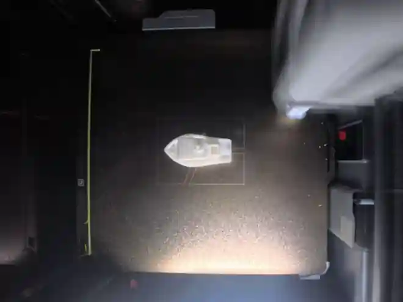
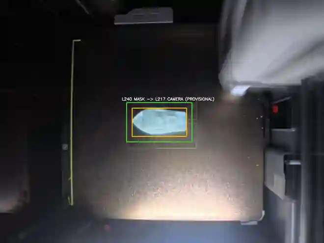
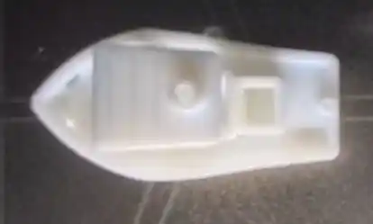

# G-code Stack Mask 기반 ROI Crop — 이미지로 보는 1차 PoC

> **출처 및 구성:** [원본 프로젝트의 ROI Crop Stack PoC](https://github.com/minhosong-mse/modulino-vision_CV_FPGA/tree/main/cv/experiments/roi_crop_stack_poc)의 실험 기록을 바탕으로 실행 스크립트와 테스트를 함께 배치한 독립 저장소입니다. 아래의 실험 수치와 검증 범위는 원본 기록이며 새로운 실험 결과가 아닙니다.

**CV Team 최강민 | 실험 2026-11-10 / 문서 갱신 2026-11-11 (Asia/Seoul)**  
**코드 검증:** ROI 연산·Crop 기능 PoC 및 단위 테스트 3/3 PASS  
**미검증:** 독립 카메라 보정, 동 레이어 정합 정확도, G-code 단독 좌표 결정

> 이 예시는 **L240 G-code Stack Mask**와 **L217 카메라 사진**을 사용한다. 파일명의 레이어 번호가 다르며, 시험용 Affine 계수는 카메라 사진 속 출력물 외곽을 참고하여 구했다. 따라서 이미지는 **Crop 모듈이 작동함을 보여주는 시각적 데모**이지, 동일 레이어 출력 품질 비교나 독립적 위치 추정 성능 검증이 아니다.

## 전체 파이프라인

```text
G-code Stack Mask (2048×2048)                 Camera frame (2048×1536)
       │                                               │
       ▼                                               │
Gray > 10 → 출력 예상 영역 이진화                      │
       ▼                                               │
findNonZero → Bounding Box                              │
       ▼                                               │
임시 mask_to_camera_affine_2x3 적용                     │
       ▼                                               │
Margin 35px 및 이미지 경계 clipping                     │
       └─────────────────────┬─────────────────────────┘
                             ▼
                    ROI Overlay 및 Crop
                             ▼
                 Crop 이미지 (414×249)
```

## ① 입력 — G-code Stack Mask에서 예상 영역 읽기



- 합성 마스크의 **검정색은 배경**, **회색은 누적 출력 예상 영역**, **흰색은 해당 레이어의 출력 라인**으로 사용한다.
- 현재 PoC에서는 회색과 흰색을 **모두 포함**해 관심 영역의 외곽을 구한다. 실제 촬영 사진에서 같은 임계값을 사용하지 않는다.
- 입력 원본 파일: `layer_0240.png` (2048×2048 RGBA). 위 이미지는 **256×256 축소 WebP 미리보기**다.

관련 함수: [`read_stack_mask()`](../../src/roi_crop_stack.py).

```python
_, binary = read_stack_mask("layer_0240.png", threshold=10)
# 실제 함수 내부: binary = np.uint8(gray > threshold) * 255
```

**결과:** 전경 `128,757px` 추출(전체 Mask 픽셀의 약 `3.07%`).

## ② 입력 — 실제 촬영 카메라 사진



- 파일명 `bambu_p1s_651_L217_중앙조절.jpg` (2048×1536).
- 베드, 프린터 헤드, 조명 반사 등이 포함되어 **전체 프레임을 그대로 처리할 필요가 없다**는 상황을 보여준다.
- 위 이미지는 **660×495 축소 WebP 미리보기**이며, 원본 JPG 전체 해상도는 Google Drive/기존 로컬 자료로 관리한다.

## ③ G-code Mask Bounding Box와 카메라 좌표 변환

관련 함수: [`mask_bbox_xyxy()`, `get_affine()`, `compute_roi()`](../../src/roi_crop_stack.py).

```python
points = cv2.findNonZero(binary)        # 검은색이 아닌 전경 좌표
x, y, w, h = cv2.boundingRect(points)  # 최소 외접 사각형
mask_bbox = (x, y, x + w, y + h)        # 오른쪽·아래쪽 배타적
```

**Mask 기준 Bounding Box:** `[744, 879, 1304, 1169)` → **560×290px**.

실험용 변환은 [`demo_calibration.json`](demo_calibration.json)에 저장했다.

```python
# 설명용: 실제 구현은 4개 모서리에 2×3 affine을 적용한다.
x_camera = 0.6142857143 * x_mask + 377.9714286
y_camera = 0.6172413793 * y_mask + 140.4448276
```

**카메라상 변환된 예상 영역:** `[835, 683, 1179, 862)` → **344×179px**.  
이 변환은 **출력물 위치를 참조해 맞춘 임시 값**이다. 카메라 중심·수직 설치만으로 구한 값이 아니다.

## ④ Margin을 적용한 최종 ROI 좌표 표시



색상 설명:
- **청록색 반투명 영역:** 임시 Affine 변환을 적용한 Stack Mask 예측 영역
- **노란색 경계:** 변환된 G-code Stack Mask Bounding Box
- **초록색 경계:** 카메라 좌표계에서 사방에 **35px Margin**을 더한 실제 Crop 사각형

관련 함수: [`compute_roi()`, `make_preview()`](../../src/roi_crop_stack.py).

```python
# 개념 코드. 실제 함수는 네 꼭짓점 모두를 투영하고
# floor/ceil·영상 범위 제한·경계 예외 처리를 함께 수행한다.
x1 = max(0, 835 - 35)
y1 = max(0, 683 - 35)
x2 = min(camera_width, 1179 + 35)
y2 = min(camera_height, 862 + 35)
# (x1, y1, x2, y2) = (800, 648, 1214, 897)
```

마지막 좌표는 **`[x1, y1, x2, y2)` (우측/하단 exclusive)** 형식이다.

## ⑤ 실제 Crop 출력



관련 함수: [`process()`](../../src/roi_crop_stack.py).

```python
x1, y1, x2, y2 = result["camera_crop_xyxy_exclusive"]
crop = camera[y1:y2, x1:x2]
cv2.imwrite("roi_crop.jpg", crop)
```

- 최종 Crop 좌표: `[800, 648, 1214, 897)`.
- 최종 이미지 해상도: **414×249px**.
- 원본 카메라 `2048×1536=3,145,728px` → Crop `414×249=103,086px`.
- **처리 대상 픽셀 약 96.72% 감소**(단순 면적 비교). 처리 속도 개선율, 출력 검출 정확도, Segmentation 성능은 **측정하지 않았다**.
- 육안으로 이 한 프레임에서 출력물이 ROI에 포함되고 프린터 헤드 등 외부 배경 상당 부분이 제외됨을 확인했다.

위 GitHub 이미지들은 **문서용 작은 WebP 미리보기**다. 원본 고해상도 사진과 정확한 생성 JPG/PNG 파일은 이 저장소에 포함하지 않는다. 파일명·전체 원본 해시: [IMAGE_ASSETS.md](IMAGE_ASSETS.md).

## ⑥ 실행 및 검증 재현

Python 3.10 이상 및 OpenCV/NumPy 필요. 저장소 루트에서 **원본 2개를 로컬에 준비한 뒤** 실행한다.

```bash
python -m pip install -r requirements.txt
python src/roi_crop_stack.py \
  --mask /local/path/layer_0240.png \
  --camera /local/path/bambu_p1s_651_L217_중앙조절.jpg \
  --calibration experiments/roi_crop_stack_poc/demo_calibration.json \
  --output-dir /local/path/roi_output \
  --margin 35
python -m unittest discover -s tests -p 'test_roi_crop_stack.py' -v
```

스크립트 출력: `roi_overlay.jpg` / `roi_crop.jpg` / `stack_binary.png` / `roi_metadata.json`.

| 검증 항목 | 결과 / 판정 |
|---|---|
| 마스크 이진화 → Bounding Box | 560×290px, **코드 동작 확인** |
| 임시 Affine → Margin → Crop | 414×249px, **코드 동작 확인** |
| 단위 테스트(경계 포함 bbox/affine+margin/empty+clipping) | **3/3 PASS** |
| 출력물의 Crop 영역 포함 여부 | **한 프레임에서 육안 확인** |
| 동 레이어 정합·독립 카메라 보정·좌표 오차/IoU | **미검증** |
| 다양한 레이어·조명·색상, 속도 및 Segmentation 평가 | **미검증** |

상세 검증 기록: [IMAGE_VERIFICATION.md](IMAGE_VERIFICATION.md) · [좌표/설정 결과 JSON](roi_metadata.json) · [원본/미리보기 자료 목록](IMAGE_ASSETS.md).

## 후속 과제

1. L217 촬영 사진과 동일한 G-code Mask 레이어를 확보해 **정확한 1:1 데이터 대응을 확인**.
2. 베드 기준점 등 **출력물과 독립된 기준**으로 카메라 ↔ Mask 변환 추정(추후 보정·원근변환 포함).
3. 정합 오차·Crop 누락 영역·여러 레이어 재현성을 측정하고 ROI 확장 폭을 비교.
4. 확정된 Crop에 대해 Grayscale / HSV / RGB 전처리 후보를 비교.

CV↔FPGA 공통 포맷은 [docs/INTERFACE.md](https://github.com/minhosong-mse/modulino-vision_CV_FPGA/blob/main/docs/INTERFACE.md)의 **DRAFT/미합의** 상태다. 본 PoC의 Affine/JSON은 확정 인터페이스가 아니다.
